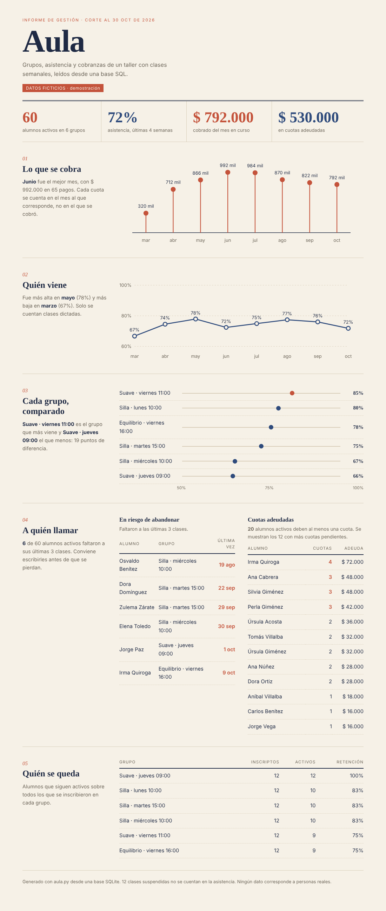

# Aula

Base de datos SQL y análisis en Python para llevar el control de **grupos, asistencia y cobranzas** de un taller con varias clases por semana. Genera un informe visual que responde las preguntas que importan al organizar los grupos: ¿quién está por abandonar?, ¿quién debe cuotas?, ¿qué grupo viene menos?, ¿cuánto se cobró?

> **Todos los datos son ficticios.** Los nombres, la asistencia y los pagos se generan con un programa y una semilla fija. No hay ninguna persona real en este repositorio.



Informe completo: [`informe.html`](informe.html) (se abre con el navegador).

## El problema

Con varios grupos que se reúnen una vez por semana, la información queda repartida: quién viene, quién pagó, qué clases se suspendieron. Mirando listas sueltas es difícil notar a tiempo que alguien dejó de venir o que se acumulan cuotas sin cobrar. Aula junta todo en una base ordenada y lo convierte en un informe de una página.

## Qué incluye

| Archivo | Para qué sirve |
|---|---|
| `schema.sql` | Tablas, restricciones, índices y una vista |
| `consultas.sql` | Las consultas de análisis, cada una con nombre y comentario |
| `datos.py` | Generador de datos ficticios (reproducible) |
| `aula.py` | Crea la base, corre las consultas y escribe el informe |
| `test_aula.py` | 26 pruebas |
| `informe.html` | Informe de ejemplo ya generado |

## Modelo de datos

```
grupos ──< alumnos ──< asistencias >── clases >── grupos
              │
              └──< pagos
```

- **grupos**: nombre, sede, día, hora, precio mensual.
- **alumnos**: pertenecen a un grupo; tienen fecha de alta y, si se fueron, de baja.
- **clases**: una por semana por grupo. Pueden estar suspendidas (`dictada = 0`).
- **asistencias**: una fila por alumno y por clase dictada mientras estuvo inscripto.
- **pagos**: una cuota por alumno y por mes.

La base se protege a sí misma con restricciones: no se puede pagar dos veces el mismo mes (`UNIQUE`), la asistencia solo vale 0 o 1 (`CHECK`), la baja no puede ser anterior al alta, un alumno necesita un grupo que exista (clave foránea) y el medio de pago es uno de una lista.

## Consultas que vale la pena mirar

- **Riesgo de abandono** (`riesgo_abandono`): usa una *función de ventana* (`ROW_NUMBER() OVER (PARTITION BY alumno ORDER BY fecha DESC)`) para numerar las clases de cada alumno desde la más reciente, y se queda con quienes faltaron a las últimas tres.
- **Cuotas adeudadas** (`deuda`): una *CTE recursiva* genera la lista de meses, se cruza con los meses en que cada alumno estuvo inscripto y un `LEFT JOIN` contra `pagos` deja las cuotas sin pago.
- **Asistencia** (`asistencia_por_grupo`, `asistencia_mensual`): se calcula solo sobre clases efectivamente dictadas, así una clase suspendida por feriado no baja el porcentaje.

Todas reciben la fecha de corte como parámetro (`:hoy`), por eso el informe se puede calcular "como estaba" en cualquier día.

## Cómo correrlo

Necesita Python 3.9 o más nuevo. No requiere instalar nada: usa solo la biblioteca estándar.

```
python aula.py
```

Crea `aula.db`, genera los datos y escribe `informe.html`. Opciones:

```
python aula.py --hoy 2026-09-30     # informe con otra fecha de corte
```

Para explorar la base a mano se puede abrir `aula.db` con [DB Browser for SQLite](https://sqlitebrowser.org/) o con `sqlite3 aula.db`.

## Pruebas

```
python test_aula.py
```

Son 26 pruebas en tres grupos:

- **Consultas sobre una base chica armada a mano**, donde cada resultado se puede calcular con lápiz y papel (por ejemplo, 3 presentes de 6 registros dan 50 %). Una de ellas confirma que una clase suspendida no cuenta.
- **Restricciones**: la base rechaza pagos duplicados, asistencia inválida, fechas incoherentes y grupos inexistentes.
- **Datos generados**: misma semilla, misma base; ninguna asistencia fuera de la inscripción del alumno ni en clases suspendidas; ningún pago posterior a la baja.

También se comprobó que las pruebas fallan cuando se rompe una consulta a propósito.

## Decisiones

| Decisión | Motivo |
|---|---|
| SQLite | Es un solo archivo, no requiere servidor y las consultas funcionan igual en otros motores |
| Las consultas viven en `consultas.sql` y no dentro del código Python | Se pueden leer, probar y modificar sin tocar el programa |
| Un alumno pertenece a un solo grupo | Simplifica el modelo; está anotado como mejora posible |
| Informe en un solo HTML con gráficos SVG propios, en estilo editorial (papel crema, tinta azul y terracota) | Se abre en cualquier dispositivo sin servidor ni librerías, se adapta al celular y al modo oscuro, y cada gráfico trae una frase que lo interpreta |
| Semilla fija en el generador | Los resultados son reproducibles y las pruebas son estables |

## Cómo se desarrolló

Lo planteé a partir de cómo se organizan los talleres con varios grupos y lo desarrollé con Claude como asistente de programación. Yo definí el problema, las preguntas que el informe debe responder y el estilo visual, y revisé el resultado.

## Limitaciones y próximos pasos

- Un alumno no puede estar en dos grupos a la vez (haría falta una tabla intermedia `inscripciones`).
- La cuota es la misma para todos los meses; no contempla aumentos, becas ni descuentos.
- No hay interfaz para cargar datos: se trabaja sobre datos generados. Un siguiente paso sería un formulario simple para registrar asistencia y pagos.
- El informe es una foto a una fecha; se podría agregar una versión que se actualice sola.
